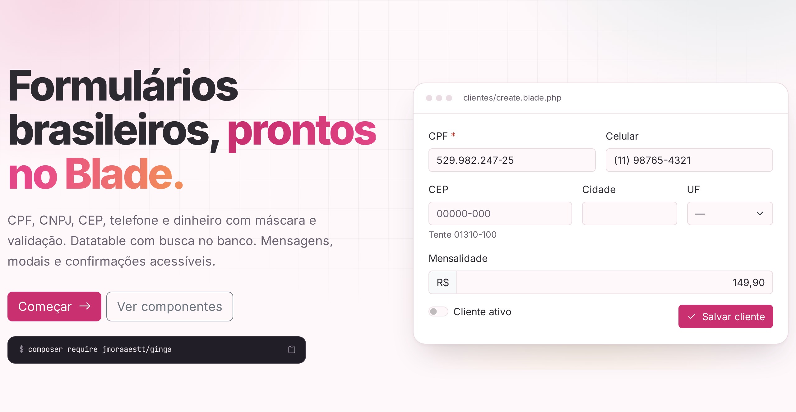
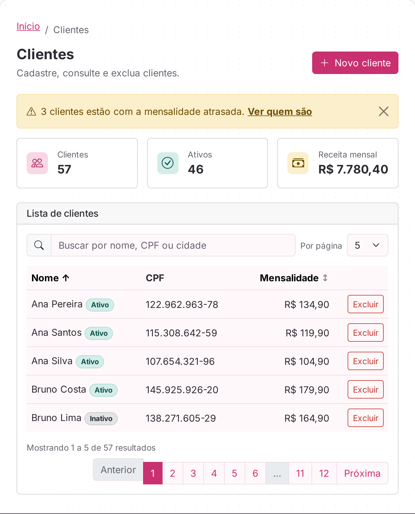

<div align="center">


# Ginga

**Componentes Blade com Bootstrap 5 para aplicações Laravel brasileiras.**

CPF, CNPJ, CEP, telefone e dinheiro com máscara e validação. Datatable com busca no banco.<br>
Mensagens, modais e confirmações acessíveis. Tudo em português.

[](https://jmoraaestt.github.io/ginga/)


[](LICENSE)

[**Documentação**](https://jmoraaestt.github.io/ginga/) ·
[Instalação](https://jmoraaestt.github.io/ginga/instalacao) ·
[Componentes](https://jmoraaestt.github.io/ginga/#componentes) ·
[Exemplo completo](https://jmoraaestt.github.io/ginga/exemplo)

<br>

<a href="https://jmoraaestt.github.io/ginga/">
  <picture>
    <source media="(prefers-color-scheme: dark)" srcset=".github/assets/heroi-dark.png">
    
  </picture>
</a>

</div>

## Por que Ginga

Todo formulário repete o mesmo trabalho: label, mensagem de erro, valor antigo, máscara, teclado certo no celular, atributos de acessibilidade. O Ginga faz isso por você, campo por campo:

```blade
<x-ginga::cpf name="cpf" required />
```

Essa linha gera o label com asterisco, a máscara `000.000.000-00`, o teclado numérico no celular, o valor digitado de volta depois de um erro e a mensagem de validação embaixo do campo, ligada a ele por `aria-describedby`.

- **Campos brasileiros:** CPF, CNPJ (inclusive o [alfanumérico](https://jmoraaestt.github.io/ginga/campos-brasileiros)), CPF ou CNPJ, telefone fixo e celular, dinheiro, UF e CEP com busca no ViaCEP.
- **Validação no servidor:** regras `cpf`, `cnpj`, `cpf_cnpj`, `cep`, `telefone` e `uf`, com mensagens em português.
- **Datatable no banco:** busca, ordenação e paginação na consulta, sem recarregar a página e com a URL sempre atualizada.
- **Acessível por padrão:** `aria-invalid`, `fieldset` com `legend`, foco devolvido ao fechar modais, anúncios para leitores de tela.
- **Tema com modo escuro:** cores trocáveis por variáveis CSS.
- **Sem build:** funciona só com Blade e o CDN do Bootstrap. Com Vite também.

## Instalação

```bash
composer require jmoraaestt/ginga
```

O pacote se registra sozinho. Não há nada para publicar: o tema é servido pelo próprio pacote.

Coloque três componentes no layout:

```blade
<head>
    <x-ginga::styles />   {{-- Bootstrap + tema do Ginga --}}
</head>
<body>
    {{ $slot }}

    <x-ginga::flash />    {{-- mensagens da sessão como toasts --}}
    <x-ginga::scripts />  {{-- JavaScript do Bootstrap --}}
</body>
```

## Exemplo

```blade
<form method="POST" action="{{ route('clientes.store') }}">
    @csrf
    <x-ginga::input name="nome" label="Nome" required />
    <x-ginga::cpf name="cpf" required />
    <x-ginga::telefone name="celular" />
    <x-ginga::cep name="cep" :preencher="['logradouro' => 'endereco', 'localidade' => 'cidade', 'uf' => 'uf']" />
    <x-ginga::button type="submit">Salvar</x-ginga::button>
</form>
```

```php
$request->validate([
    'nome' => 'required|string|max:100',
    'cpf' => 'required|cpf',
    'celular' => 'nullable|telefone',
    'cep' => 'nullable|cep',
]);

return redirect()->route('clientes.index')->with('sucesso', 'Cliente salvo.');
```

Os campos ganham máscara, o CEP preenche o endereço, o erro aparece embaixo do campo certo e o `flash` mostra "Cliente salvo." no canto da tela.

Uma listagem com busca e paginação no banco:

```php
$clientes = Tabela::de(Cliente::query())
    ->buscarEm(['nome', 'cpf', 'cidade'])
    ->ordenarPor(['nome', 'mensalidade'], padrao: 'nome')
    ->paginar();
```

```blade
<x-ginga::datatable :tabela="$clientes" :columns="['nome' => 'Nome', 'cpf' => 'CPF', 'acoes' => ['label' => 'Ações', 'hidden' => true]]">
    @foreach ($clientes as $cliente)
        <tr>
            <td>{{ $cliente->nome }}</td>
            <td>@cpf($cliente->cpf)</td>
            <td><x-ginga::delete-button :action="route('clientes.destroy', $cliente)" :item="$cliente->nome" /></td>
        </tr>
    @endforeach
</x-ginga::datatable>
```

<div align="center">
  <a href="https://jmoraaestt.github.io/ginga/exemplo">
    <picture>
      <source media="(prefers-color-scheme: dark)" srcset=".github/assets/exemplo-dark.png">
      
    </picture>
  </a>
  <br>
  <sub><a href="https://jmoraaestt.github.io/ginga/exemplo">Ver a tela completa e o código</a></sub>
</div>

## Componentes

Cada link leva à página com exemplos rodando, o código de cada um e a tabela de props.

| Grupo | Componentes |
|-------|-------------|
| Mensagens | [`alert`](https://jmoraaestt.github.io/ginga/alert) · [`toast` e `flash`](https://jmoraaestt.github.io/ginga/toast) · [`modal`](https://jmoraaestt.github.io/ginga/modal) |
| Ações | [`button`](https://jmoraaestt.github.io/ginga/button) · [`delete-button` e `confirm-delete`](https://jmoraaestt.github.io/ginga/exclusao) |
| Formulários | [`input`](https://jmoraaestt.github.io/ginga/input) · [`select`](https://jmoraaestt.github.io/ginga/select) · [`multiselect`](https://jmoraaestt.github.io/ginga/multiselect) · [`textarea`](https://jmoraaestt.github.io/ginga/textarea) · [`checkbox` e `switch`](https://jmoraaestt.github.io/ginga/checkbox) · [`checkbox-group` e `radio-group`](https://jmoraaestt.github.io/ginga/grupos) |
| Campos brasileiros | [`cpf`, `cnpj`, `cpf-cnpj`, `telefone`, `dinheiro`, `uf`](https://jmoraaestt.github.io/ginga/campos-brasileiros) · [`cep`](https://jmoraaestt.github.io/ginga/cep) · [regras e diretivas](https://jmoraaestt.github.io/ginga/validacao) |
| Listagens | [`datatable`](https://jmoraaestt.github.io/ginga/datatable) · [`table`](https://jmoraaestt.github.io/ginga/table) · [`pagination`](https://jmoraaestt.github.io/ginga/pagination) · [`badge`](https://jmoraaestt.github.io/ginga/badge) |
| Estrutura | [`card`](https://jmoraaestt.github.io/ginga/card) · [`breadcrumb`](https://jmoraaestt.github.io/ginga/breadcrumb) |
| Tema | [cores, modo escuro e variáveis CSS](https://jmoraaestt.github.io/ginga/tema) |

## Requisitos

| | Versão |
|-|--------|
| PHP | 8.2 ou mais novo |
| Laravel | 11, 12 ou 13 |
| Bootstrap | 5.3, pelo CDN (padrão) ou pela sua aplicação |

## Desenvolvimento

```bash
composer install
composer test
```

Os testes usam [Pest](https://pestphp.com) e [Orchestra Testbench](https://packages.tools/testbench) e cobrem as regras de validação, as máscaras, o HTML de cada componente, o `old()` e os erros depois de um envio, a `Tabela` com SQLite em memória e a compilação de todas as views.

A documentação é um app Laravel em [`docs/`](docs/) que usa o próprio pacote. Para rodar localmente ou mudar uma página, veja o [README da documentação](docs/README.md). Cada push na `main` publica o site no GitHub Pages.

## Licença

[MIT](LICENSE) © Júlia Toledo
